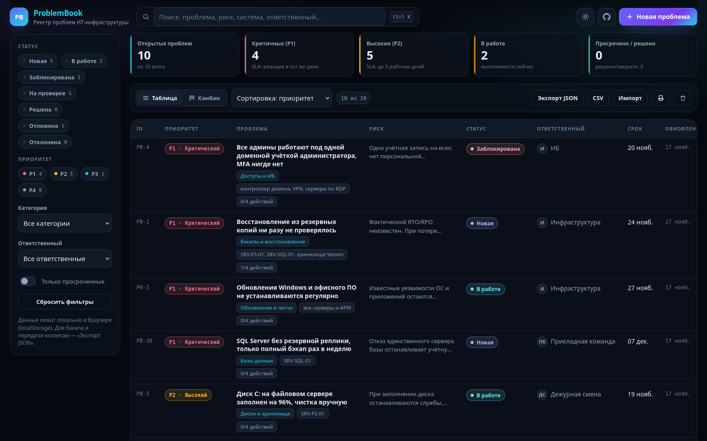

# ProblemBook — реестр проблем ИТ-инфраструктуры

Проблембук для ИТ-директора: единый список того, что сломано или опасно в инфраструктуре, чем это грозит, что нужно сделать, чем рискуем при починке, с каким приоритетом и в каком статусе.

Репозиторий: [github.com/CDSosobist/ProblemBook](https://github.com/CDSosobist/ProblemBook) · Живая версия: [cdsosobist.github.io/ProblemBook](https://cdsosobist.github.io/ProblemBook/)

Статический сайт без зависимостей и сборки: открывается двойным щелчком по `index.html` или раздаётся любым веб-сервером. Данные живут в браузере (localStorage), выгружаются в JSON/CSV.

К операционной системе не привязан — это обычная веб-страница, работать с ней можно с любого рабочего места. Демо-примеры написаны под типовую корпоративную Windows-инфраструктуру (домен, WSUS, SQL Server, бэкапы, RDP), но в реестр можно заносить что угодно: сеть, 1С, сервисы, подрядчиков, процессы.



---

## Как открыть

**Вариант 1 — просто файл:** двойной щелчок по `index.html` (Windows или macOS) либо `xdg-open index.html` в Linux.

**Вариант 2 — локальный сервер (удобнее для нескольких вкладок):**

```bash
./serve.sh          # http://127.0.0.1:8000/
./serve.sh 9000     # другой порт
```

**Публикация на GitHub Pages** включена: Source «Deploy from a branch», ветка `main`, папка `/ (root)`. Любой пуш в `main` пересобирает сайт за минуту — живая версия `https://cdsosobist.github.io/ProblemBook/`.

Репозиторий публичный намеренно: бесплатный GitHub Pages работает только для публичных репозиториев. Секретов, доступов и внутренних адресов в коде нет — реестр проблем хранится в браузере пользователя, а не в репозитории.

---

## Что в карточке проблемы

| Поле | Смысл | Обязательность |
|---|---|---|
| **Проблема** | Что именно не так в инфраструктуре. Коротко, проверяемо. | Да |
| **Риск от проблемы** | Что произойдёт, если не делать ничего: простой, потеря данных, штрафы, репутация. | Сильно желательно |
| **Необходимые действия** | Что нужно сделать. Одна строка = один пункт чек-листа, его можно отмечать выполненным. | Да |
| **Риски при реализации** | Что может сломаться, пока чиним: окна простоя, откат, зависимости, подрядчики. | Желательно |
| **Приоритет** | P1–P4, задаёт порядок работ и SLA реакции. | Да |
| **Статус** | Новая → В работе → На проверке → Решена; плюс Заблокирована, Отложена, Отклонена. | Да |
| **Примечания** | Ссылки, договорённости, контекст, что уже пробовали. | По ситуации |

Дополнительно (мои добавления, чтобы реестр был рабочим инструментом, а не списком страхов):

- **Категория** — Бэкапы, Обновления и патчи, Мониторинг, Доступы и ИБ, Сеть и DNS, Диски, Виртуализация, Базы данных, CI/CD, Документация, Люди и процессы, Электропитание/ЦОД.
- **Ответственный** — без имени проблема не двигается.
- **Системы / хосты** — где именно наблюдается проблема (`srv-db-01`, `k8s-prod`).
- **Срок** — целевая дата; просроченные подсвечиваются красным и считаются в KPI.
- **Трудозатраты, ч/д** — чтобы планировать загрузку команды и аргументировать бюджет.
- **История** — автоматический журнал: создание, смена статуса, правки, отметки по чек-листу. Показывает, кто когда что менял, без отдельного чата.

## Приоритеты и SLA

| Приоритет | Что это | SLA реакции |
|---|---|---|
| **P1 · Критический** | Останавливает бизнес или грозит потерей данных / утечкой | В тот же день, эскалация до ИТ-директора |
| **P2 · Высокий** | Серьёзный риск, есть обходной путь | До 5 рабочих дней |
| **P3 · Средний** | Технический долг, деградация, удобство | До 30 календарных дней |
| **P4 · Низкий** | Гигиена, «когда будет время» | Бэклог |

SLA — соглашение, а не жёсткий дедлайн: подсказка нужна, чтобы P1 не тонули среди P3.

## Возможности интерфейса

- **Таблица** с поиском, фильтрами по статусу/приоритету/категории/ответственному и сортировкой (приоритет, срок, дата обновления, дата создания, название).
- **Канбан** по статусам с перетаскиванием карточек (drag & drop меняет статус и пишет историю).
- **Карточка проблемы** (боковая панель): риск, чек-лист действий с прогрессом, риски реализации, примечания, детали, история.
- **KPI-панель**: открытых, критичных P1, высоких P2, в работе, просрочено/закрыто.
- **Тёмная и светлая темы**; при первом запуске берётся системная настройка, выбор запоминается.
- **Экспорт**: JSON (полный бэкап, переносится между браузерами и людьми) и CSV (Excel/LibreOffice, BOM и `;` — откроется без пляски с кодировкой).
- **Импорт JSON** с заменой реестра; предыдущее состояние сохраняется в браузере как резервная копия.
- **Печать / PDF**: печатные стили разворачивают таблицу, скрывают панели — годится для отчёта руководству.
- **Пустое состояние** с кнопкой «Загрузить демо-примеры» — 10 типовых проблем корпоративной инфраструктуры (бэкапы, патчи, доступы, диск, мониторинг, БД, процессы), чтобы увидеть формат и заменить своими.
- **Горячие клавиши**: `Ctrl/⌘ K` — поиск, `N` — новая проблема, `Esc` — закрыть карточку/форму, `/` — поиск.

## Где хранятся данные

`localStorage`, ключ `problembook.v1` (и `problembook.backup` — предыдущее состояние при импорте/очистке).

Практические следствия:

1. Данные привязаны к браузеру и профилю. Другой компьютер, режим инкогнито, «очистить данные сайтов» — реестр будет пустым.
2. Поэтому регулярный **Экспорт JSON** — это и есть бэкап. Разумно держать его в git-репозитории или в облаке компании.
3. Для командной работы файл можно положить на общий ресурс и периодически импортировать/экспортировать, но настоящая многопользовательская работа требует серверной части (см. «Что дальше»).

## Структура проекта

```
index.html            разметка приложения (шапка, фильтры, таблица, канбан, карточка, форма)
assets/styles.css     все стили: тёмная/светлая темы, печатная версия, адаптив
assets/app.js         состояние, рендер, CRUD, фильтры, импорт/экспорт, горячие клавиши
tests/ui_tests.js     браузерные смоук-тесты (чёрный ящик через DOM)
tests/run_ui_tests.py запуск тестов в headless Firefox
serve.sh              локальный статический сервер
docs/screenshot.png   скриншот с демо-данными
```

Разметка, стили и логика разделены; внешних библиотек и шрифтов нет — страница работает офлайн.

## Тесты

```bash
python3 tests/run_ui_tests.py                 # нужен только Firefox
python3 tests/run_ui_tests.py --size 1600,1100 # проверка вёрстки на конкретной ширине
```

Скрипт собирает `.selftest.html` (копия `index.html` с подключённым тестом), запускает headless Firefox и проверяет 50+ сценариев: создание проблемы со всеми полями, смену статуса, чек-лист, поиск и «ничего не найдено», фильтры, канбан и drag & drop, редактирование без дубликатов, валидацию, дублирование, удаление с отменой, экспорт CSV/JSON, импорт, отсутствие горизонтальной прокрутки и вылезающих элементов, сохранность данных после перезагрузки страницы.

## Что дальше (осознанные ограничения)

- Нет серверного хранения и авторизации: файл — инструмент одного ИТ-директора или временный командный реестр. Следующий шаг — бэкенд с базой, SSO, роли и аудит.
- Нет связки с тикетницей: кандидат на интеграцию — Jira/YouTrack по кнопке «создать задачу из проблемы».
- Нет напоминаний по SLA: можно добавить уведомления (Telegram-бот, почта) на просроченные P1/P2.
- Нет вложений и ссылок на графики мониторинга: поле «Ссылки» намеренно заменено заметками, чтобы не тащить файловое хранилище.

---

Автор: [github.com/CDSosobist](https://github.com/CDSosobist)
